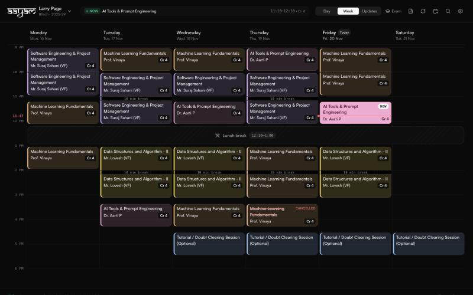
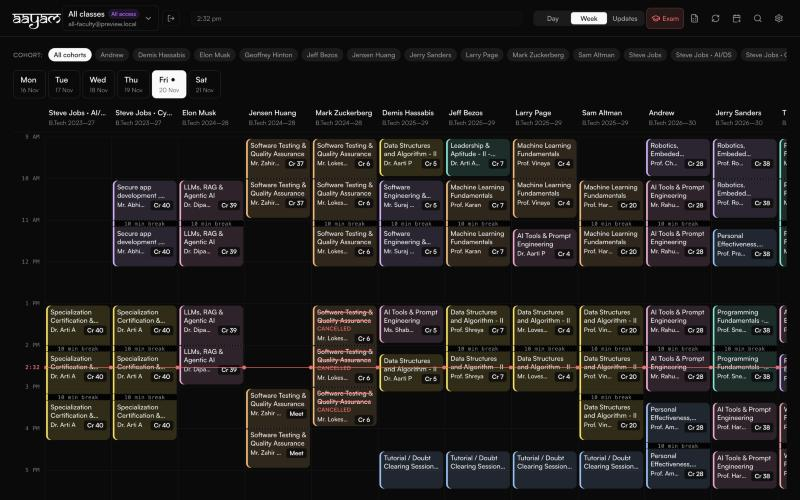
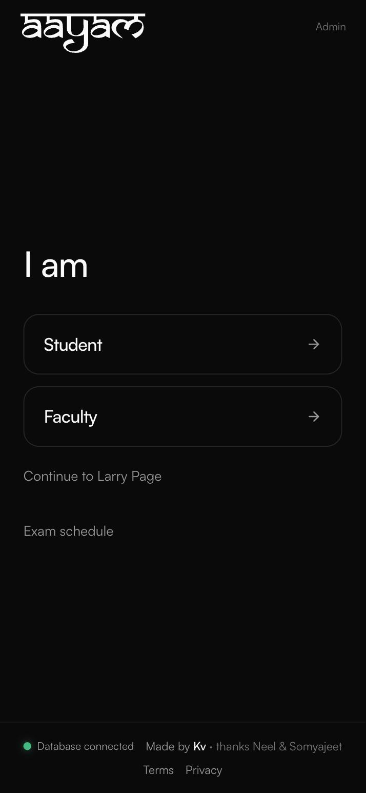
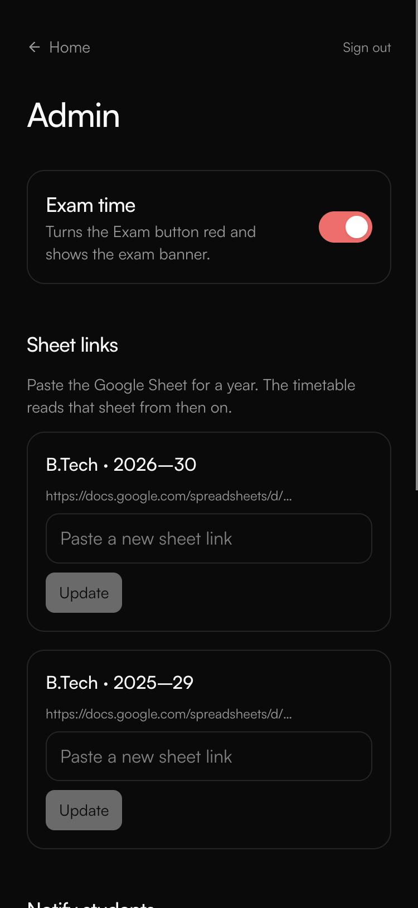
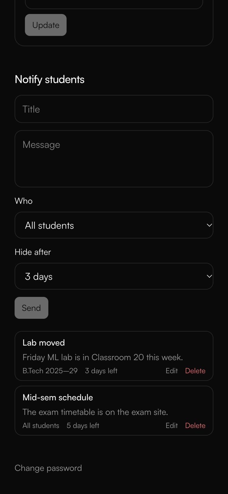

<h1 align="center">Aayam · आयाम</h1>

<p align="center">
  <b>A live college timetable that reads straight from the Google Sheet. Every student and teacher sees their own week, and hears when a class moves.</b><br>
  Runs entirely on free plans: Cloudflare Workers + D1 serve it, GitHub Actions does the heavy work. → <a href="https://aayam.kv404.dev">aayam.kv404.dev</a>
</p>

<p align="center">
  
  
  
  
  
  
</p>

<p align="center">
  
</p>

---

## What it does

The timetable office keeps editing the same public Google Sheet it always has. Aayam reads it every few minutes, works out what changed, and shows everyone their own week. Aayam never writes to the sheet.

```
Google Sheet ──xlsx──► sync job (GitHub Actions) ──► D1 ──► Worker (/api) ──► phone / laptop
 (one per batch)        download · parse · diff        prebuilt     one row lookup,
                        archive · prebuild replies     replies      ETag / 304
                        · send push alerts
```

| Who | What they get |
|---|---|
| **Students** (no account) | Pick a batch, then a section. Day view on a phone, hour-grid week on a laptop. Change alerts, reminders 10 and 5 minutes before class, a calendar feed (`.ics`). |
| **Faculty** (Google sign-in, college domains) | Every lecture they teach, across all batches, on one grid. |
| **Coordinators** | Every class in the cohorts they own, and any teacher's week. |
| **Full access staff** | Every class, or one whole batch, as a board with one column per cohort. Any cohort, any teacher. |
| **Admins** (`/admin`) | Repoint a batch to next week's sheet, post notices that expire on their own, edit and push them again, switch on exam time. |

## Headline numbers

| | |
|---|---|
| **5** batches · **14** cohorts | B.Tech and MCA, about **400** classes a week |
| **~0.3 ms** | Worker CPU per timetable read (the free limit is 10 ms) |
| **150–400 ms** | CPU to parse one sheet, which is why the Worker never does it |
| **~5 min** | from a sheet edit to every phone; **~1 min** after an admin change |
| **~12 / hour** | API calls from an open tab, **0** from a hidden one, mostly `304 Not Modified` |
| **~3** | D1 rows written by a sync where nothing changed |
| **₹0** | monthly cost: Workers Free, D1 Free, GitHub Actions |

---

## A tour of the app

All screenshots are dark mode, taken from the live timetable.

### Week view

The picture at the top. An hour grid like a phone calendar. Classes are sized by their length. Two periods of the same class stay two cards, joined by a strip that shows the short break. A lunch at the same time on neighbouring days is one band. A red line marks the time now. Cancelled classes keep their colour, struck through, with a *Cancelled* label.

### All classes and whole batches

Staff with full access see every cohort at once: a tab for each day, one column per cohort, grouped by batch. They can narrow it to one batch (say B.Tech 2025–29), one cohort, or one teacher. Hovering a card opens it in full: subject, teacher, room and time.



### On a phone, and for admins

<table>
<tr>
<td width="25%"><b>Home</b><br><sub>Student or faculty. A student picks a batch, then a section.</sub><br></td>
<td width="25%"><b>Day view</b><br><sub>Today's classes with time, teacher and room. The live class is solid.</sub><br></td>
<td width="25%"><b>Admin</b><br><sub>Exam time switch, and a sheet link per batch.</sub><br></td>
<td width="25%"><b>Notices</b><br><sub>Pick who sees it and when it hides. Edit, push again, delete.</sub><br></td>
</tr>
</table>

### Android app

An Android app (Expo) in `mobile/` shows the site itself, so it always matches the web. It adds push alerts for changes and notices, and class reminders that arrive with the app closed. It also keeps the last timetable for when you are offline, and has two home-screen widgets: Next class and Today. Download the APK from [Releases](https://github.com/Kv-404/Aayam/releases).

<details>
<summary><b>Rules the sheet follows</b> (click)</summary>
<br>

- A class is cancelled by writing `OFF`, `cancelled` or `holiday`, or by filling the subject cell red. A red class keeps its subject name.
- A class removed from a day that is still on the sheet stays on the grid as cancelled. A whole day removed from the sheet drops off the grid.
- A new sheet whose dates do not overlap the current week starts a fresh week with no change alerts.

Full rules: [`docs/agent/sheet.md`](docs/agent/sheet.md).
</details>

---

## How it works

```
 Google Sheets (public xlsx export, one per batch)
          │  every 5 min, or right after an admin change
          ▼
 ┌──────────────────────────────┐        ┌─────────────────────────────────┐
 │ Sync job · GitHub Actions    │ writes │ Cloudflare D1                   │
 │ download · parse · find      ├───────▶│ • sheet links (set at /admin)   │
 │ changes · archive · prebuild │        │ • lecture archive + change log  │
 │ every API reply · send push  │        │ • prebuilt replies (snapshots)  │
 └──────────────▲───────────────┘        │ • faculty, admin, notices, push │
                │ dispatch               └───────────────▲─────────────────┘
                │                                        │ one query per request
 ┌──────────────┴────────────────────────────────────────┴─────────────────┐
 │ Cloudflare Worker · static React app (free) + /api/*                    │
 │ under 10 ms CPU per request: look up a row, stitch, answer (ETag/304)   │
 └─────────────────────────────────────────────────────────────────────────┘
```

| Part | Tech | Job |
|---|---|---|
| Web app | React, Vite, Tailwind | Static files, served free. Polls about every 5 min while visible, never while hidden. |
| API | Cloudflare Worker, no npm packages, no Node APIs | One D1 query per read: the prebuilt timetable, sync status, live notices and the exam flag together. |
| Database | Cloudflare D1 (SQLite) | Sheet links, prebuilt replies, the week archive, change log, notices, push subscriptions. |
| Sync job | Node 24 on GitHub Actions, ExcelJS | Downloads and parses each sheet, finds changes, renders every reply ahead of time. |
| Alerts | Web Push (VAPID) | Sent by the job, never the Worker, so encryption cost stays off the 10 ms budget. |

> Why the split: reading one sheet takes 150–400 ms of CPU, and a free Worker gets 10 ms. So the job does all the parsing on GitHub's runners and stores a ready reply for every request the site can make. The Worker only looks it up and sends it.

---

## Run it locally

```bash
npm install
npm run dev     # Worker + local D1 on :8787, sync job every 2 min, Vite on :5173
```

| Command | What |
|---|---|
| `npm test` | server, sync job and Worker tests |
| `npm run typecheck` | TypeScript, server and client |
| `npm run build` | client → `client/dist` |
| `npm run check:worker` | bundle the Worker as Cloudflare would, no deploy |
| `npm run sync` | run the sync job once against D1 |

Sheet links come from D1, not env vars: `migrations/0003_seed_sheet_links.sql` seeds the current sheets into the local database. Worker secrets for local runs go in `.dev.vars`; the job's settings go in `.env` (see `.env.example`).

## Deploy

Every push to `main` is typechecked, tested, built, migrated (D1) and deployed by `.github/workflows/deploy.yml`, then runs one sync. One-time setup (Cloudflare and GitHub tokens, secrets, the domain) is in [`docs/agent/deploy.md`](docs/agent/deploy.md).

## Project layout

```
client/            React app: Dashboard, WeeklyView + TimeGrid, TodayView, Setup, AdminPage
server/src/edge/   Cloudflare Worker: /api routes, auth, admin, push sign-up
server/src/job/    sync job: pipeline, archive, snapshots, pushes
server/src/services/  sheet download, parser, change detection
server/src/views.ts   builds every API reply ahead of time
shared/            types, scope keys, faculty name matching, calendar file
migrations/        D1 schema, add-only
docs/agent/        design notes: client, server, sheet, deploy
docs/screenshots/  images used in this README
mobile/            Android app (Expo): the site in a webview, plus push, reminders and widgets
```

## Security

The repo is public and holds no secrets. `.env*` and `.dev.vars` are git-ignored. Production secrets are Cloudflare Worker secrets and GitHub Actions secrets. The sheets are view-only, and the browser never gets a Google key. Faculty sessions are HMAC-signed `HttpOnly` cookies. Admin logins are rate-limited. Report security issues privately, as [SECURITY.md](SECURITY.md) says.

## Contributing

See [CONTRIBUTING.md](CONTRIBUTING.md). AI coding agents should start with [AGENTS.md](AGENTS.md).

## License

[GNU Affero General Public License v3.0 only](LICENSE). Copyright (C) 2026 Kv-404. If you share a copy, or run a changed copy as a website, you must publish that source under the same license.

Source: [github.com/Kv-404/Aayam](https://github.com/Kv-404/Aayam)
