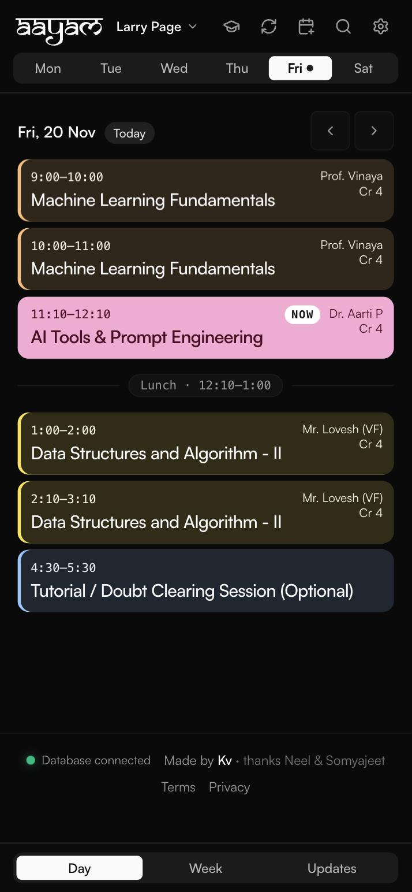

# Aayam · आयाम

**A live college timetable that reads straight from the Google Sheet.** → [aayam.kv404.dev](https://aayam.kv404.dev)

The timetable office keeps editing the same public Google Sheet it always has. Aayam reads it every few minutes, works out what changed, and shows every student and teacher their own week. When a class is moved or cancelled, they get told about it. Aayam never writes to the sheet.

Everything runs on free plans: Cloudflare Workers and D1 serve the site, and GitHub Actions does the heavy work.


<table>
  <tr>
    <td width="50%"></td>
    <td width="50%"></td>
  </tr>
  <tr>
    <td align="center">Day view on a phone</td>
    <td align="center">Home: student or faculty</td>
  </tr>
</table>

---

## What it does

**Students** (no account)
- Pick a batch, then a section. The phone remembers the choice.
- **Week view**: an hour grid like a phone calendar. Classes are sized by their length, a red line marks the time now, and a break shared by neighbouring days is one band. Two periods of the same class in a row are joined into one block, with the 10 minute break between them shown.
- **Day view**: on a phone, a short list for today.
- Cancelled classes stay on the grid in their colour, struck through, with a *Cancelled* label.
- Change alerts and lecture reminders, 10 and 5 minutes before a class and when it starts.
- Calendar feed (`.ics`) for Google, Apple, Outlook and Proton.

**Faculty** (Google sign-in, college domains only)
- Every lecture they teach, across all batches, on one grid.
- Coordinators see their cohorts. Staff with full access see every class, or one whole batch, as a board with one column per cohort and a tab for each day.

**Admins** (`/admin`)
- Paste next week's sheet link for a batch. It is stored in D1 and the new timetable is live in about a minute, together with the header's *Open sheet* link.
- Post notices to students, sent as push notifications. Each one hides itself after 1 to 30 days. Edit a notice, push it again, or delete it.
- Turn on **exam time**: the Exam button goes red and the exam banner shows. No extra requests; it rides on the normal timetable read.

## How it works

```
 Google Sheets (public xlsx export, one per batch)
          │  every 5 min, or right after an admin change
          ▼
 ┌──────────────────────────────┐        ┌─────────────────────────────────┐
 │ Sync job · GitHub Actions    │ writes │ Cloudflare D1                   │
 │ download · parse · find      ├───────▶│ • sheet links (set at /admin)   │
 │ changes · archive · prebuild │        │ • lecture archive + change log  │
 │ every API reply · send push  │        │ • prebuilt replies (snapshots)  │
 └──────────────▲───────────────┘        │ • faculty, admin, notices, push │
                │ dispatch               └───────────────▲─────────────────┘
                │                                        │ one lookup per request
 ┌──────────────┴────────────────────────────────────────┴─────────────────┐
 │ Cloudflare Worker · static React app (free) + /api/*                    │
 │ under 10 ms CPU per request: look up a row, stitch, answer (ETag/304)    │
 └─────────────────────────────────────────────────────────────────────────┘
```

Reading one sheet takes 150–400 ms of CPU. A free Worker gets 10 ms. So the job does all the parsing on GitHub's runners and stores a ready reply for every request the site can make. The Worker only looks up that row and sends it.

| Part | Tech |
| --- | --- |
| Web app | React, Vite, Tailwind |
| API | Cloudflare Worker, no npm packages, no Node APIs |
| Database | Cloudflare D1 (SQLite) |
| Sync job | Node 24 on GitHub Actions, ExcelJS |
| Alerts | Web Push (VAPID), sent by the job |

### Rules the sheet follows

- A class is cancelled by writing `OFF`, `cancelled` or `holiday`, or by filling the subject cell red. A red class keeps its subject name.
- A class removed from a day that is still on the sheet stays on the grid as cancelled. A whole day removed from the sheet drops off the grid.
- A new sheet whose dates do not overlap the current week starts a fresh week with no change alerts.

Full rules: [`docs/agent/sheet.md`](docs/agent/sheet.md).

## Run it locally

```bash
npm install
npm run dev     # Worker + local D1 on :8787, sync job every 2 min, Vite on :5173
```

```bash
npm test              # server, sync job and Worker tests
npm run typecheck
npm run build         # client → client/dist
npm run check:worker  # bundle the Worker as Cloudflare would
```

Sheet links come from D1, not from env vars. `migrations/0003_seed_sheet_links.sql` seeds the current sheets into the local database. Worker secrets for local runs go in `.dev.vars`. The job's other settings go in `.env` (see `.env.example`).

## Repo layout

```
client/      React app (Dashboard, WeeklyView + TimeGrid, TodayView, Setup, AdminPage)
server/src/
  edge/      Cloudflare Worker: /api routes, auth, admin, push sign-up
  job/       sync job: pipeline, archive, snapshots, pushes
  services/  sheet download, parser, change detection
  views.ts   builds every API reply ahead of time
shared/      types, scope keys, faculty name matching, calendar file
migrations/  D1 schema, add-only
docs/agent/  design notes: client, server, sheet, deploy
docs/screenshots/  images used in this README
```

## Deploy

Every push to `main` is typechecked, tested, built, migrated (D1) and deployed by `.github/workflows/deploy.yml`, then runs one sync. One-time setup (Cloudflare and GitHub tokens, secrets, the domain) is in [`docs/agent/deploy.md`](docs/agent/deploy.md).

**Free plan budget**: bootstrap takes about 0.3 ms of Worker CPU. A visible tab makes about 12 API calls an hour and a hidden tab none. An unchanged sync writes about 3 D1 rows.

## Security

The repo is public and holds no secrets. `.env*` and `.dev.vars` are git-ignored. Production secrets are Cloudflare Worker secrets and GitHub Actions secrets. The sheets are view-only, and the browser never gets a Google key. Faculty sessions are HMAC-signed `HttpOnly` cookies. Admin logins are rate-limited. Report security issues privately, as [SECURITY.md](SECURITY.md) says.

## Contributing

See [CONTRIBUTING.md](CONTRIBUTING.md). AI coding agents should start with [AGENTS.md](AGENTS.md).

## License

[GNU Affero General Public License v3.0 only](LICENSE). Copyright (C) 2026 Kv-404. If you share a copy, or run a changed copy as a website, you must publish that source under the same license.

Source: [github.com/Kv-404/Aayam](https://github.com/Kv-404/Aayam)
