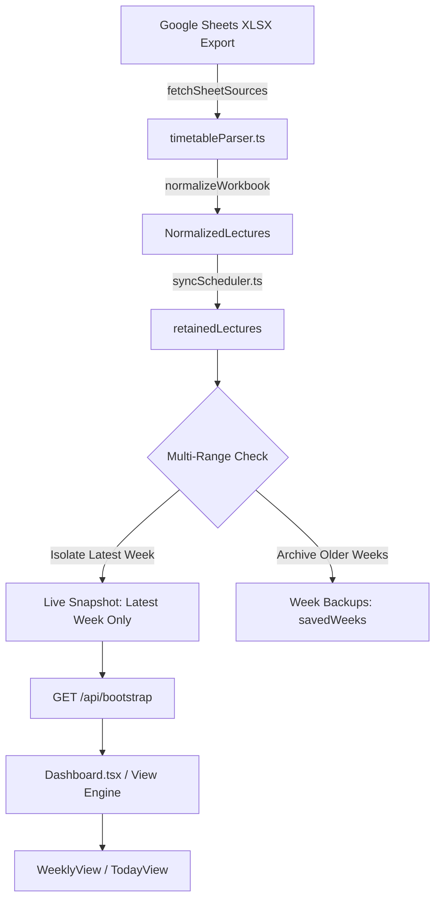
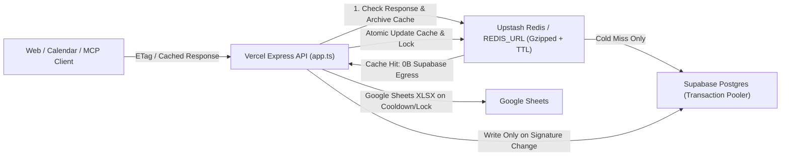

# Technical Architecture: Week Range Isolation & Faculty View Engine

## 1. Architectural Overview



---

## 2. Week Range Isolation Specification

### Problem
Sheets from different batches (or tabs within a workbook) can contain different date ranges. In the current implementation:
- `dates = lectures.map(l => l.date).filter(Boolean).sort()` sorts ascending.
- `dates[0]` is selected as `weekStart` (earliest date).
- `WeeklyView` sorts `days` ascending, rendering columns from the oldest date.
- `Dashboard.tsx` falls back to `days[0]`, locking users into the earliest timetable.

### Solution Algorithm
1. **Week Anchor Function**:
   Using `mondayOf(isoDate: string)`:
   $$\text{Monday}(D) = D - ((\text{DayOfWeek}(D) + 6) \pmod 7)$$
2. **Latest Week Determination**:
   ```ts
   const datedLectures = lectures.filter((l) => Boolean(l.date));
   const mondays = [...new Set(datedLectures.map((l) => mondayOf(l.date!)))].sort();
   const latestMonday = mondays[mondays.length - 1];
   ```
3. **Filtering**:
   - In active live mode (`weekId === "live"`), lectures with dates matching `mondayOf(l.date) === latestMonday` (plus any recurring/undated lectures) are presented as the active timetable.
   - Any lectures belonging to earlier Mondays are categorized under `savedWeeks` (or filtered out of live display).
   - This ensures that `days[0]` and default view rendering always align with the **latest timetable**.

---

## 3. Faculty Grid Architecture & Layout Repair

### Issue 1: Multi-Card Cell Height Explosion in `WeeklyView`
- **Current Behavior**: If 10 cohorts have class at 10:00 AM on Monday, each card is rendered at full height in `<div className="space-y-2">`, stretching the table cell to >1500px.
- **Architectural Fix**:
  - Implement a dense multi-class cell representation:
    - If a cell has $\le 2$ lectures: Render standard cards.
    - If a cell has $> 2$ lectures: Render compact multi-cohort summary cards with cohort badge, concise subject, teacher, and room chip (`text-xs`, tight padding).
    - Provide an expandable disclosure toggle or cohort filter bar to inspect all cohorts cleanly without breaking the grid geometry.

### Issue 2: CSS Multi-Column Bug in `FacultyScopeMenu`
- **Current Behavior**:
  `<div className="overflow-y-auto lg:columns-2 lg:gap-1.5">`
  CSS columns in an overflow container cause split element boundaries, clipped hover states, and vertical-first ordering issues.
- **Architectural Fix**:
  Replace `lg:columns-2` with:
  `<div className="overflow-y-auto grid grid-cols-1 lg:grid-cols-2 gap-2 items-start">`
  This guarantees standard CSS Grid box-model containment, preventing section splitting.

### Issue 3: Desktop Header Jumps
- **Current Behavior**:
  At `xl` breakpoint (1280px–1536px), `{statusLine}` drops out of the main toolbar into a full-width second row solely when `role === "faculty"`.
- **Architectural Fix**:
  Keep the top navigation bar unified on a single row, optimizing label truncation and badge spacing.

---

## 4. Phase 6 Architecture: Redis Caching & Supabase Egress Mitigation

### Root Cause of Supabase Egress Exhaustion
1. `hydrateArchive()` (`durableState.ts`) executes `readRemote()` on every Vercel cold start (`/tmp/timetable.sqlite` is ephemeral), downloading **both** the monolithic `timetable_archive` JSONB blob (`readBlob()`) **and** all rows across live + 15 historical weeks (`readNeonRows()`).
2. `publishArchive()` checks module-scoped `lastSignature` (empty on cold lambdas), calls `readRemote()` again, and rewrites all rows (`DELETE FROM timetable_lectures` + full re-insert).
3. `lastSyncBySheet` (`app.ts`) and `pinRateLimiter` / `loginRateLimiter` (`auth.ts`) are in-memory `Map`s per lambda, causing duplicate syncs and uncoordinated Postgres queries across instances.
4. No Redis response cache or HTTP `ETag`/`304` exists for `/api/bootstrap`, `/api/week`, `/api/changes`, or `/api/calendar.ics`.

### Solution Architecture



#### 4.1 Dual-Driver Redis Layer (`server/src/services/redis.ts`)
- **Mode 1 — Upstash REST** (`@upstash/redis`): Auto-selected when `UPSTASH_REDIS_REST_URL` + `UPSTASH_REDIS_REST_TOKEN` (or `KV_REST_API_URL` + `KV_REST_API_TOKEN`) are configured. Zero TCP connection churn on Vercel serverless.
- **Mode 2 — Standard Redis TCP** (`ioredis`): Selected when `REDIS_URL` (or `KV_URL`) is configured (supports `redis://`, `rediss://`).
- **Mode 3 — In-Memory Fallback**: Deterministic TTL/NX/INCR store used automatically in local dev/unit tests when no Redis env is present.
- **Payload Compression**: Large JSON blobs (`tt:v2:archive:live`, `tt:v2:week:*`) use `gzipSync` + base64 (`gz:<b64>`), cutting size ~10x.

#### 4.2 Egress-Free Cold Starts & Differential Postgres Sync
1. **Redis-First Archive Hydration**:
   - `tt:v2:archive:live` stores live lectures + live changes + sync state + week summaries (`WeekBackupSummary[]`).
   - `tt:v2:week:<id>` stores individual past week backups (`WeekBackupRecord`), populated lazily on demand.
   - `tt:v2:archive:sig` stores the SHA-256 signature of the last published archive so cold lambdas skip `readRemote()` during `publishArchive()`.
2. **Eliminating Postgres Double-Read & Over-Fetch**:
   - On Redis miss, `readRemote()` checks lightweight timestamps/hashes (`timetable_sync` vs `timetable_archive.updated_at`) instead of downloading both `timetable_archive.archive` and all normalized tables simultaneously.
   - Cold hydration queries **only** `week_id = 'live'` lectures/changes + `timetable_weeks` metadata (`readNeonLiveRows`), leaving historical weeks in Postgres until explicitly requested via `/api/week?monday=...` (which caches each fetched week in Redis for 24h!).
   - `writeNeonRows` performs scoped updates (`week_id = 'live'` and only newly added/updated `week_id` backups) rather than deleting and rewriting unchanged historical weeks, while keeping `timetable_archive` updated only when live/weeks actually changed.
3. **Distributed Sync Cooldown, Lock & Rate Limiting**:
   - `tt:v2:sheet:last:<sheetId>` and `tt:v2:sync:lock` (NX + TTL) ensure at most one Vercel instance syncs a sheet per `SYNC_INTERVAL_SECONDS`.
   - `pinRateLimiter`, `loginRateLimiter`, and OAuth rate limiters use atomic Redis `INCR` + `PEXPIRE` sliding/fixed windows across all serverless instances.
4. **Scoped HTTP Response Cache & `ETag` (`304 Not Modified`)**:
   - Cache scoped `/api/bootstrap`, `/api/week`, `/api/changes`, `/api/calendar.ics` payloads in Redis keyed by `contentHash` + query scope (short TTL 45–120s, invalidated on sync).
   - Compute weak/strong `ETag` headers so 4-second polling & repeated client loads receive `304 Not Modified`.
5. **Auth Directory & PIN Cache**:
   - Cache `faculty_directory` lookups (`tt:v2:auth:faculty:<emailHash>`, TTL 10m) and throttle `last_login_at` Postgres writes (`tt:v2:auth:login-touch:<id>`, TTL 1h).
   - Cache `batch_access_codes` verification results (`tt:v2:auth:pin:<sha256(pin)>`, TTL 10m).

---

## 5. Phase 7 & 8 Architecture: Remote MCP Server & OAuth 2.1 for Confidential Data

### 5.1 OAuth 2.1 Security Architecture (`server/src/mcp/oauth.ts` & `oauthStore.ts`)
Our Express app exposes both the **OAuth 2.1 Authorization Server** and the **Protected MCP Resource Server**:

- **Discovery Endpoints**:
  - `GET /.well-known/oauth-protected-resource` (and `/mcp` subpath variant) — RFC 9728 metadata pointing `authorization_servers` to our origin and declaring supported scopes (`timetable:read`, `faculty:self`, `coordinator:read`, `faculty:all`, `faculty:directory`).
  - `GET /.well-known/oauth-authorization-server` (plus `/.well-known/openid-configuration` alias) — RFC 8414 metadata advertising `client_id_metadata_document_supported: true` (CIMD), `registration_endpoint` (DCR), `code_challenge_methods_supported: ["S256"]`, `grant_types_supported: ["authorization_code", "refresh_token"]`, and `revocation_endpoint`.
- **Client Identification (CIMD + DCR)**:
  - **CIMD (Preferred, MCP 2025-11-25)**: When `client_id` is an `https://` URL, fetch and validate the JSON metadata document (SSRF-guarded against private/loopback IPs, cached in Redis for 10m), verify `doc.client_id === client_id`, and enforce exact `redirect_uri` match.
  - **DCR (Fallback, RFC 7591)**: `POST /oauth/register` validates `redirect_uris` (HTTPS or `http://localhost`/`127.0.0.1`), rate-limits by IP in Redis, and persists client records in Redis (`tt:v2:oauth:client:<id>`).
- **Upstream Identity & Consent (`GET /oauth/authorize` → Google OAuth → `/oauth/callback` → `POST /oauth/consent`)**:
  - Enforces OAuth 2.1 mandatory `code_challenge_method=S256` and exact `redirect_uri` + RFC 8707 `resource` audience validation.
  - Redirects to Google OAuth 2.0 Authorization Code flow (`openid email profile`, `prompt=select_account`).
  - Verifies returned Google ID token (`aud`, `iss`, `nonce`, `email_verified`, `ALLOWED_EMAIL_DOMAINS`: `itm.edu`, `isu.ac.in`), then looks up the user in `faculty_directory` (`is_active = true`, Redis-cached). Non-directory or inactive accounts fail closed!
  - Presents a CSRF-protected HTML consent page showing client identity, faculty email, and granted scopes; approval mints a 60s single-use authorization code stored in Redis (`tt:v2:oauth:code:<code>`).
- **Token Issuance, Audience Binding & Rotation (`POST /oauth/token`, `POST /oauth/revoke`)**:
  - Verifies PKCE `S256` challenge with constant-time comparison, client credentials (if confidential), `redirect_uri`, and RFC 8707 `resource`.
  - Mints HMAC-SHA256 signed MCP Access Token (1h TTL) bound strictly to `aud = canonicalMcpResourceUrl` and `jti` stored in Redis (`tt:v2:oauth:at:<jti>`) for instant revocation, plus opaque Refresh Token (30d TTL, SHA-256 hashed in Redis with rotation & reuse detection).
  - **No Token Passthrough**: Web session tokens (`signSession`) and Google tokens are rejected on `/mcp`; `/mcp` accepts only MCP-audience OAuth tokens.

### 5.2 Remote Streamable-HTTP MCP Server (`server/src/mcp/server.ts`)
- Mounted at `/mcp` (and `/api/mcp` alias) using `@modelcontextprotocol/sdk` (`McpServer` + `StreamableHTTPServerTransport` with `sessionIdGenerator: undefined` for stateless Vercel compatibility).
- Protected by `requireMcpAuth` middleware: returns `401 Unauthorized` with `WWW-Authenticate: Bearer resource_metadata="..."` when unauthenticated or invalid.
- Validates `Origin` header to prevent DNS rebinding while permitting non-browser MCP hosts and HTTPS connector origins.
- **RBAC-Scoped Tools** (all with explicit MCP annotations `title`, `readOnlyHint`, `destructiveHint`, `idempotentHint`):
  - `get_my_profile`: Authenticated faculty identity, permissions, coordinator cohorts, and scopes.
  - `get_my_schedule`: Authenticated teacher's personal lectures (live or past week), strictly scoped to `auth.facultyName`.
  - `get_cohort_timetable`: Cohort/division timetable lookup for live or past weeks.
  - `list_cohorts_and_weeks`: Available cohorts, batches, live range, and past `savedWeeks`.
  - `get_timetable_changes`: Timetable edits/cancellations/room moves (`mine`, `cohort`, or `all` gated by `canSeeAllFaculty` / coordinator cohorts).
  - `find_free_rooms_or_slots`: Room availability / free slot finder for a date/weekday and time window.
  - `get_faculty_schedule` *(Confidential)*: Look up another faculty member's schedule — requires `faculty:all` (`can_see_all_faculty`) or coordinator ownership of the cohort; denied otherwise.
  - `list_faculty_directory` *(Confidential)*: Returns `faculty_directory` records (names, emails, `can_see_all_faculty`, `is_active`, `last_login_at`) — strictly gated on `faculty:directory` (`can_see_all_faculty = true`).
  - `get_calendar_subscription_info`: Builds `.ics` subscription URL for the faculty member or a cohort.
  - `refresh_timetable_sync` *(Privileged Write)*: Triggers a sheet sync (respecting Redis sync cooldown), gated on `can_see_all_faculty` or coordinator role.

---

## 6. Phase 10 Architecture: Client MCP Install Generator (`client/src/lib/mcpInstall.ts` & `McpConnectModal.tsx`)

- **Origin Resolution**: `mcpEndpointUrl()` automatically resolves `${window.location.origin}/mcp` in production (falling back to `https://timetable.kv404.dev/mcp` when developing on `localhost` if the user toggles production vs local URL).
- **Client-Specific Install Builders**:
  - **Claude**: Custom connector instructions (`Settings → Connectors → Add custom connector`).
  - **Claude Code**: `claude mcp add --transport http aayam-timetable <url> --scope user`.
  - **Cursor**: `cursor://anysphere.cursor-deeplink/mcp/install?name=aayam-timetable&config=<base64({url})>` + `~/.cursor/mcp.json`.
  - **VS Code**: `vscode:mcp/install?<encodeURIComponent(JSON.stringify({name,type:"http",url}))>` + `.vscode/mcp.json`.
  - **ChatGPT**: Developer Mode custom MCP connector setup (`Settings → Apps & Connectors`).
  - **Windsurf**: `~/.codeium/windsurf/mcp_config.json` with `serverUrl`.
  - **Gemini CLI**: `~/.gemini/settings.json` with `httpUrl`.
- **Entry Points**: Accessible from the `Dashboard` header (desktop/tablet `Connect AI` trigger), `AppearanceMenu` Settings on all screen sizes (mobile & desktop), and the landing page footer/actions.
