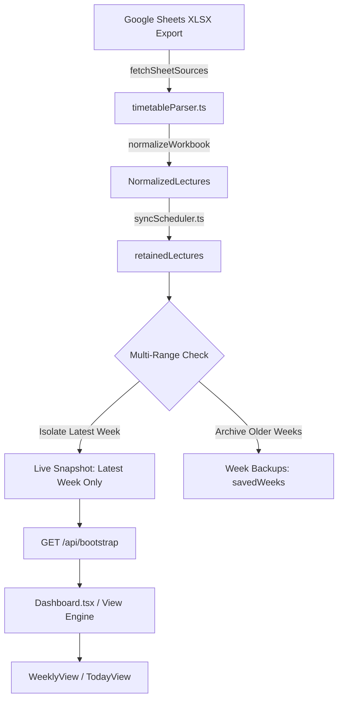

# Technical Architecture: Week Range Isolation & Faculty View Engine

## 1. Architectural Overview



---

## 2. Week Range Isolation Specification

### Problem
Sheets from different batches (or tabs within a workbook) can contain different date ranges. In the current implementation:
- `dates = lectures.map(l => l.date).filter(Boolean).sort()` sorts ascending.
- `dates[0]` is selected as `weekStart` (earliest date).
- `WeeklyView` sorts `days` ascending, rendering columns from the oldest date.
- `Dashboard.tsx` falls back to `days[0]`, locking users into the earliest timetable.

### Solution Algorithm
1. **Week Anchor Function**:
   Using `mondayOf(isoDate: string)`:
   $$\text{Monday}(D) = D - ((\text{DayOfWeek}(D) + 6) \pmod 7)$$
2. **Latest Week Determination**:
   ```ts
   const datedLectures = lectures.filter((l) => Boolean(l.date));
   const mondays = [...new Set(datedLectures.map((l) => mondayOf(l.date!)))].sort();
   const latestMonday = mondays[mondays.length - 1];
   ```
3. **Filtering**:
   - In active live mode (`weekId === "live"`), lectures with dates matching `mondayOf(l.date) === latestMonday` (plus any recurring/undated lectures) are presented as the active timetable.
   - Any lectures belonging to earlier Mondays are categorized under `savedWeeks` (or filtered out of live display).
   - This ensures that `days[0]` and default view rendering always align with the **latest timetable**.

---

## 3. Faculty Grid Architecture & Layout Repair

### Issue 1: Multi-Card Cell Height Explosion in `WeeklyView`
- **Current Behavior**: If 10 cohorts have class at 10:00 AM on Monday, each card is rendered at full height in `<div className="space-y-2">`, stretching the table cell to >1500px.
- **Architectural Fix**:
  - Implement a dense multi-class cell representation:
    - If a cell has $\le 2$ lectures: Render standard cards.
    - If a cell has $> 2$ lectures: Render compact multi-cohort summary cards with cohort badge, concise subject, teacher, and room chip (`text-xs`, tight padding).
    - Provide an expandable disclosure toggle or cohort filter bar to inspect all cohorts cleanly without breaking the grid geometry.

### Issue 2: CSS Multi-Column Bug in `FacultyScopeMenu`
- **Current Behavior**:
  `<div className="overflow-y-auto lg:columns-2 lg:gap-1.5">`
  CSS columns in an overflow container cause split element boundaries, clipped hover states, and vertical-first ordering issues.
- **Architectural Fix**:
  Replace `lg:columns-2` with:
  `<div className="overflow-y-auto grid grid-cols-1 lg:grid-cols-2 gap-2 items-start">`
  This guarantees standard CSS Grid box-model containment, preventing section splitting.

### Issue 3: Desktop Header Jumps
- **Current Behavior**:
  At `xl` breakpoint (1280px–1536px), `{statusLine}` drops out of the main toolbar into a full-width second row solely when `role === "faculty"`.
- **Architectural Fix**:
  Keep the top navigation bar unified on a single row, optimizing label truncation and badge spacing.
